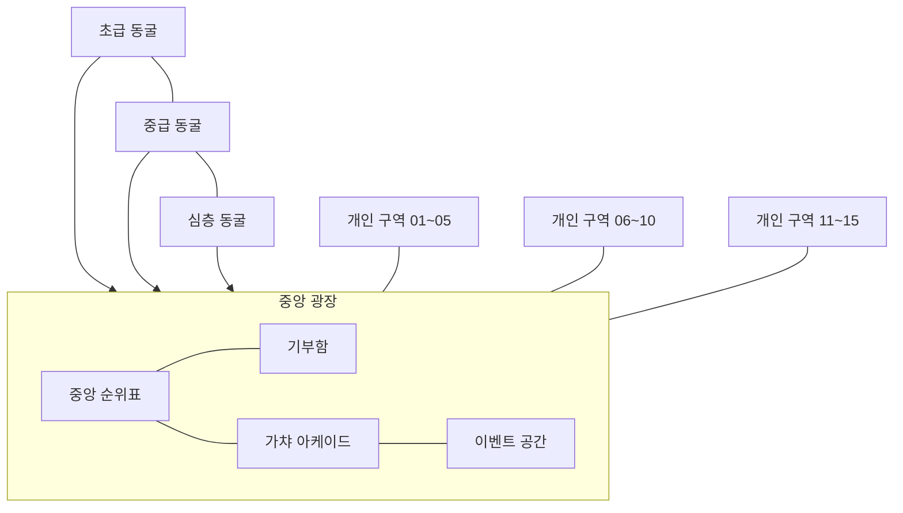

# 월드 맵 구성·배치·디자인 가이드

> **구현 기준:** 정확한 월드/Plot/던전 좌표와 치수는 [`06_월드_좌표_배치_명세.md`](06_월드_좌표_배치_명세.md)를 따른다. 이 문서는 시각적 방향과 구역 관계를 설명한다. 좌표가 다르면 06 문서가 우선한다.

## 1. 월드 원칙
- 서버 최대 15명, 개인 구역 15개.
- 플레이어는 자신의 개인 구역에서 시작한다.
- 중앙 광장은 15개 개인 구역과 공용 콘텐츠를 연결하는 허브다.
- 던전은 광장에서 입장하며 초급·중급·심층 3개 입구로 나눈다.
- 월드 전체 PvP 비활성화.
- 광장에서 개인 구역 입구와 던전 입구가 쉽게 인식되도록 한다.

## 2. 월드 전체 배치 개념



### 2.1 개인 구역 15개
- 15개 개인 구역은 반지름 250 studs의 원형으로 배치한다. 24도 간격이며 모든 입구는 중앙을 향한다.
- 모든 입구는 광장 방향을 향한다.
- 광장에서 각 입구까지 이동 거리를 최대한 균등하게 한다.
- 경계는 낮은 울타리·화단·바닥 패턴으로 표현하고 높은 벽은 피한다.
- 공통 기본 구조를 사용하고 플레이어별 장식으로 차이를 준다.

## 3. 중앙 광장
1. 중앙 순위표: 광장의 중심 또는 중심에 가까운 랜드마크.
2. 기부함: 순위표 바로 옆, 주 보행 동선을 막지 않게 배치.
3. 가챠 아케이드: 광장 북쪽 또는 후면. 티어별 기계가 깊이 방향으로 확장.
4. 이벤트 공간: 광장 가장자리의 열린 무대·정원.
5. 던전 입구: 광장 한쪽 면에 초급→중급→심층 순서.

### 3.1 동선
- 스폰 지점에서 중앙 광장으로 이어지는 밝은 크림색 길.
- 순위표·기부함 주변은 원형으로 돌아 나갈 수 있는 여유 공간.
- 가챠존과 던전 입구 사이에는 넓은 보행로.
- 던전 입구는 색·형태·아이콘을 다르게 하고 난이도 텍스트를 함께 표시한다.

## 4. 개인 구역 내부 배치

### 4.1 최신 기능 구성
- 슬라임 1개, 베이스 1종, 토핑 최대 3개.
- 노동자 1명.
- 세척대 1개, 쪼물 테이블 1개.
- 재료 진열장 1개, 토핑 진열장 1개.
- 기존 패드 3열×2행 및 패드별 슬라임 구조는 삭제한다.

### 4.2 평면 블록아웃
입구가 광장을 향한다. 입구에서 안쪽을 볼 때 왼쪽은 작업 구역, 중앙은 슬라임 중심, 오른쪽은 수납·진열 구역.

```text
┌──────────────────────────────────────────────┐
│                후면 장식 / 식물               │
│                                              │
│ [재료 진열장]       [단일 슬라임] [토핑 진열장]│
│                    (베이스 1종)               │
│ [세척대]            [쪼물 테이블]              │
│                                              │
│ [가방/도구 UI]        노동자 이동 루프         │
│                                              │
├──────────────── 입구 / 광장 방향 ─────────────┤
```

- 슬라임은 구역 중앙의 시각적 초점.
- 쪼물 테이블은 슬라임 옆에 배치.
- 세척대는 재료 진열장과 가까이 둬 발굴→귀환→세척→보관 흐름을 만든다.
- 토핑 진열장은 세척대 옆 또는 오른쪽.
- 노동자 이동 루프는 슬라임 주변의 짧은 폐곡선이며 플레이어 동선과 겹치지 않는다.

## 5. 던전 테마 디자인

### 5.1 초급 동굴
- 팔레트: 베이지·연갈색·민트.
- 넓고 시야가 트인 입구, 둥글고 낮은 바위, 부드러운 흙더미, 작은 수정과 버섯.
- 발굴 지점은 서로 너무 멀지 않게 배치한다.
- 튜토리얼과 안내 표지가 잘 보이도록 한다.

### 5.2 중급 동굴
- 팔레트: 청록·아쿠아·블루.
- 초급보다 높낮이와 지형 굴곡을 다양하게 구성한다.
- 수정 기둥, 얕은 물웅덩이, 광물 줄기로 시각적 차이를 준다.
- 흙더미가 지형에 가려지지 않도록 한다.

### 5.3 심층 동굴
- 팔레트: 라벤더·딥 퍼플·남색.
- 보라색 발광 광물과 따뜻한 조명으로 판독성을 확보한다.
- 큰 수정 군락, 깊은 굴, 광물 다리로 최종 던전 분위기를 만든다.
- 희귀 발견은 작은 빛·파티클·사운드로 표현한다.

## 6. 던전 내부 공통 배치

```text
┌────────────────────────────────────────────┐
│                 후면 랜드마크                │
│                                            │
│ 흙더미 지점 A       흙더미 지점 B            │
│                                            │
│        중앙 채굴 공간 / 시야 확보            │
│                                            │
│ 흙더미 지점 C       흙더미 지점 D            │
│                                            │
│ [베이스 펌프]                   [귀환 표식]  │
│                                            │
├────────────── 입구 / 광장 연결 ─────────────┤
└────────────────────────────────────────────┘
```

- 위 그림은 주요 지점 그룹 개념도다. 실제 활성 흙더미는 초급 18개, 중급 15개, 심층 12개.
- 베이스 펌프는 입구에서 접근하기 쉬우면서 통로를 막지 않는 곳.
- 귀환 버튼은 HUD에 고정한다. 월드 귀환 표식은 보조 요소.
- 재생성 지점은 스폰·펌프·통로·벽과 겹치지 않도록 사전 지정한다.
- 플레이어 이동이 겹치지 않도록 통로 폭과 흙더미 간격을 확보한다.

## 7. 비주얼 스타일

### 7.1 색상 팔레트
| 용도 | 색상 | HEX |
|---|---|---|
| 기본 바닥 | 크림 화이트 | #F4F0E8 |
| 개인 구역 포인트 | 파스텔 민트 | #A9DCCB |
| 개인 구역 보조 | 파우더 블루 | #B8D9EA |
| 슬라임 강조 | 젤리 핑크 | #F3AFCB |
| 초급 던전 | 베이지·민트 | #D9C7A3 / #9BCDBB |
| 중급 던전 | 아쿠아·블루 | #72C9D0 / #6F9FCB |
| 심층 던전 | 라벤더·퍼플 | #A98AD2 / #554C86 |
| 안내 UI | 딥 네이비 | #34445B |

### 7.2 형태·조명
- 모서리는 둥글게, 직각 구조물은 최소화한다.
- 장식은 크고 읽기 쉬운 실루엣을 우선한다.
- 바닥 타일은 큰 패턴으로 구성해 시각적 노이즈를 줄인다.
- 개인 구역·광장은 밝고 따뜻한 중성광.
- 던전은 테마 색 조명을 사용하되 캐릭터와 흙더미의 명암 대비를 확보한다.
- Bloom은 약하게, UI 가독성을 우선한다.

## 8. 성능 원칙
- 반복 장식은 MeshPart와 공유 에셋을 재사용한다.
- 장식물 CanCollide=false를 기본 검토.
- 주요 이동로에는 장식물을 두지 않는다.
- 토핑 최대 3개 구조에 맞춰 각 모델의 실루엣을 분명히 한다.
- 흙더미는 활성 오브젝트 수를 제한하고 재생성 지점을 재사용한다.
- 모바일 저사양 옵션에서 파티클·반사·투명 재질을 줄인다.

## 9. Studio 블록아웃 순서
1. 중앙 광장과 순위표·기부함의 박스를 배치한다.
2. 광장 외곽에 개인 구역 15개를 3개 그룹으로 배치한다.
3. 개인 구역 입구와 연결 도로를 정렬한다.
4. 개인 구역 1개를 완성해 기준 모델로 만든 후 복제한다.
5. 내부에 단일 슬라임, 쪼물 테이블, 세척대, 진열장 2개, 노동자 루프를 배치한다.
6. 광장 한쪽에 던전 입구 3개를 만든다.
7. 각 던전의 공통 동선을 만든 후 테마 지형·조명·광물로 차별화한다.
8. 모바일 카메라·길찾기·충돌·프레임을 테스트한다.

## 10. 검수 체크리스트
- [ ] 개인 구역 15개가 겹치지 않는다.
- [ ] 모든 입구가 광장 방향을 향한다.
- [ ] 순위표와 기부함이 쉽게 보인다.
- [ ] 가챠·이벤트·던전 동선이 서로 막히지 않는다.
- [ ] 던전 입구 3개가 난이도 순서대로 구분된다.
- [ ] 개인 구역 슬라임은 1개뿐이다.
- [ ] 베이스 1종과 토핑 최대 3개.
- [ ] 노동자 1명 이동 경로가 플레이어 동선을 막지 않는다.
- [ ] 세척대·쪼물 테이블·진열장 접근이 쉽다.
- [ ] 흙더미 지점이 통로·펌프·스폰과 겹치지 않는다.
- [ ] 전 구역 PvP가 불가능하다.
- [ ] 모바일에서 귀환 버튼과 가방 무게가 읽힌다.

## 11. 구현 좌표
- 좌표·치수·회전·포털 위치: `06_월드_좌표_배치_명세.md` 참조.
- 던전 흙더미 후보 좌표 배열은 MapConfig/DungeonConfig에 동일하게 정의하고, 06 문서의 고정 후보 규칙을 따른다.
- 이 문서의 ASCII 평면도는 기능 관계를 나타내는 개념도이며, 실제 배치에는 06 문서의 수치를 사용한다.
